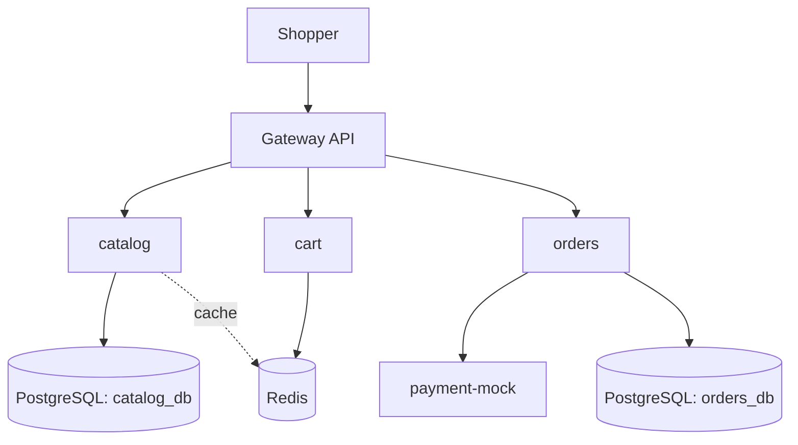

# Retail Shop: Design Doc

**Status:** Draft v1
**Author:** Dipak Prasad
**Last updated:** October 2026

## 1. Goal

A small online shop where users browse products, add them to a cart, and
place orders. The real goal is to practise running a service in production:
safe deploys, monitoring, SLOs, failure handling, and incident response.

## 2. Scope

**In scope**
- Browse products and check stock
- Add and remove items in a cart
- Place an order and pay (simulated payment)
- See order status

**Not in scope (for now)**
- Real payments, user login, product search, admin UI
- Users are identified by a simple `X-User-Id` header

## 3. Services

| Service      | What it does                         | Data store              |
|--------------|--------------------------------------|-------------------------|
| catalog      | Product list, prices, stock          | PostgreSQL (catalog_db) + Redis cache |
| cart         | Items each user wants to buy         | Redis                   |
| orders       | Checkout and order status            | PostgreSQL (orders_db)  |
| payment-mock | Pretends to be a payment gateway     | None                    |

**Why separate services?** Each part has different needs. Catalog is
read-heavy, cart is temporary, and orders must never be lost. Separate
services let each one use the right storage, scale on its own, and fail
without taking down the others.

**Honest trade-off:** at this traffic level, one app (a monolith) would be
simpler and cheaper. We split it on purpose to practise running
microservices in production.

**Why payment-mock?** It lets us control slowness and errors on purpose
(for example: 20% failures, 3-second delays) to test how the system
handles a bad dependency.

## 4. Data model

Money is stored as **whole paise (integers)**, never as decimals, to avoid
rounding errors.

**catalog_db.products**
- id, name, description, price_paise, stock, updated_at

**orders_db.orders**
- id, user_id, status, total_paise, created_at, updated_at
- status: PENDING → PAID, or PENDING → PAYMENT_FAILED

**orders_db.order_items**
- order_id, product_id, quantity, price_paise
  (price is copied at order time, so later price changes don't affect old orders)

**Redis**
- `cart:{user_id}` → list of product IDs and quantities, expires after 7 days
- `product:{id}` → cached product details, expires after 5 minutes

## 5. Checkout flow

1. User clicks checkout.
2. orders reads the cart and gets current prices from catalog.
3. orders asks catalog to reserve stock. Catalog only reduces stock if
   enough is left (`UPDATE ... WHERE stock >= quantity`), so two users
   can't buy the last item at the same time.
4. orders saves the order as PENDING.
5. orders calls payment-mock with the order ID as an **idempotency key**,
   a 2-second timeout, and up to 2 retries with backoff.
6. Payment succeeds → order becomes PAID and the cart is cleared.
   Payment fails → order becomes PAYMENT_FAILED and the stock is released.

**Known risk:** if orders crashes between step 3 and step 6, stock can stay
reserved. A cleanup job will release stock for orders stuck in PENDING for
more than 15 minutes. (We will handle this properly with events in the
payments project.)

## 6. Traffic estimates

| Item                          | Estimate            |
|-------------------------------|---------------------|
| Daily users                   | 10,000              |
| Requests per user per day     | ~20                 |
| Requests per day              | ~200,000            |
| Average requests per second   | ~2.3                |
| Evening peak (5x)             | ~12 per second      |
| Sale day (10x peak)           | ~120 per second     |
| Orders per day (3% buy)       | ~300                |
| Order data per year           | well under 1 GB     |

**What this means:** the load is small. The main challenge is reliability
(safe deploys, failures, sudden spikes), not raw scale.

## 7. SLOs

Measured over a rolling 28-day window. Only server errors (5xx) and slow
responses count as bad. User errors (4xx), like a declined card, do not.

| SLO                | Target                                   | Error budget (28 days) |
|--------------------|------------------------------------------|------------------------|
| Browse available   | 99.9% of catalog requests succeed        | ~40 minutes            |
| Browse speed       | 95% of catalog requests under 300 ms     |                        |
| Checkout success   | 99.5% of checkout requests succeed       | ~3.4 hours             |
| Checkout speed     | 99% of checkouts finish under 2 seconds  |                        |

**Why checkout is lower than browse:** checkout depends on more services
(catalog, payment), so it has more ways to fail. Setting a realistic target
is better than promising one we will always miss.

## 8. Failure modes

| What fails              | What happens                        | How we handle it                       |
|-------------------------|-------------------------------------|----------------------------------------|
| A pod crashes           | Requests to that pod fail           | 2+ replicas, probes, auto restart      |
| payment-mock is slow    | Checkout could hang                 | 2s timeout, retries, idempotency key   |
| payment-mock is down    | Checkouts fail                      | Clear error, order marked failed, alert|
| Redis is down           | Carts lost, catalog gets slower     | Catalog reads DB directly; carts are temporary by design |
| catalog_db is down      | Browse and checkout fail            | Alert, backups, managed DB later on AWS|
| Traffic spike (sale)    | Slow responses                      | Autoscaling (HPA), cache, load tests   |

## 9. Tech choices

- **Language:** Python with FastAPI
- **Runtime:** Kubernetes (kind locally, EKS on AWS later)
- **Traffic in:** Gateway API
- **Deploy:** Helm + Argo CD (GitOps)
- **Monitoring:** Prometheus, Grafana, Loki, Tempo, OpenTelemetry

## 10. Open questions

- Should catalog and orders share one PostgreSQL server locally with two
  databases, or run two servers? (Plan: one server locally, decide again on AWS.)
- Do we need a message queue for checkout now, or later?

## 11. Architecture

